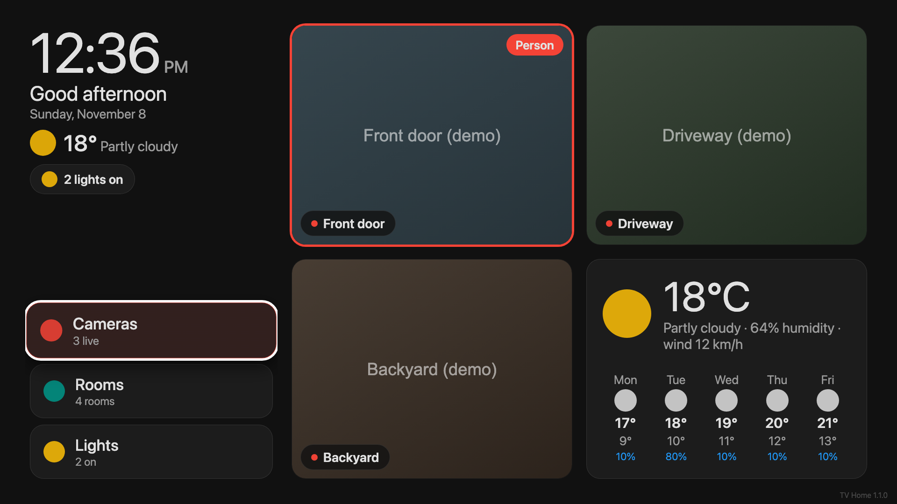
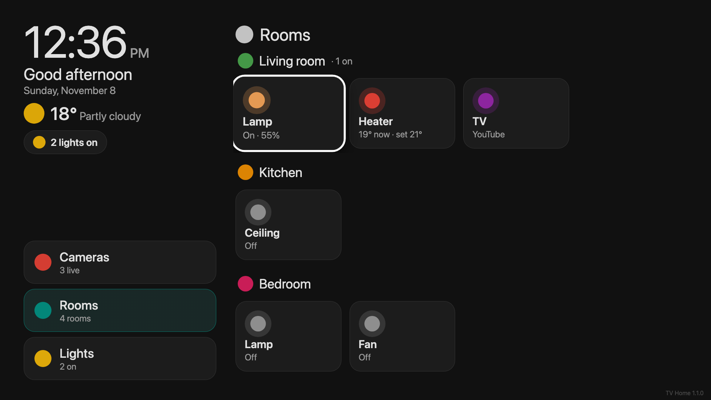
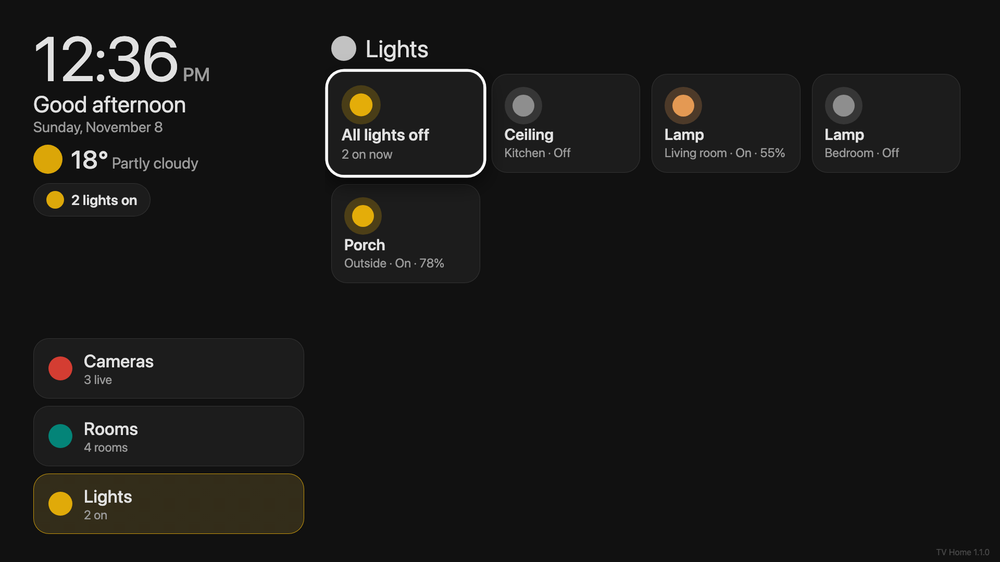

# TV Home card

A Home Assistant dashboard card made for the TV: big text, a clear focus ring, and full
control with a TV remote (arrows, OK, Back). It also works with a mouse or touch screen.

- Left rail: clock, greeting, weather, "lights on" chip, and Cameras / Rooms / Lights buttons.
- **Cameras**: up to 3 live cameras plus a weather card with a 5-day forecast. A red ring and a
  "Person" badge appear while a person sensor is on. OK opens a camera full screen, Left/Right
  switches camera, Down shows its buttons (porch light, garage door…).
- **Rooms**: one row per room with lights, fans, covers, climate, media players and sensors.
  Lights show their real colour.
- **Lights**: every light in your rooms, plus "All lights off" (asks first).
- Optional person pop-up: when someone is seen, that camera pops up on the dashboard for 30 s.
- Goes back to the cameras after 2 minutes without a key press.
- Uses your HA theme colours. One file, no build step, no dependencies.

Made for the [HA TV](https://github.com/codemastervy/ha-tv-app) Android TV app, but it works in
any browser.

| Cameras | Rooms | Lights |
|---|---|---|
|  |  |  |

Screenshots are from the offline demo with fake data (`demo/index.html`). Icons show as dots
there; in Home Assistant they are real MDI icons.

## Install

### HACS

1. HACS → three dots → Custom repositories → add `https://github.com/codemastervy/tv-home-card`,
   type **Dashboard**.
2. Install "TV Home card", then reload the browser.

### Manual

1. Copy `dist/tv-home-card.js` to `/config/www/tv-home-card.js`.
2. Settings → Dashboards → three dots → Resources → Add resource:
   URL `/local/tv-home-card.js?v=1`, type **JavaScript module**.
   (Bump `?v=` when you update the file, so TVs and browsers fetch the new version.)
3. Reload the browser.

## Make the TV dashboard

1. Settings → Dashboards → Add dashboard → New dashboard from scratch. Name it "TV".
2. Open it → pencil (top right) → three dots → Raw configuration editor.
3. Paste [`example.yaml`](example.yaml), change the entity IDs to yours, save.
4. Open it with `?kiosk` at the end to hide HA's header and sidebar, e.g.
   `http://homeassistant.local:8123/dashboard-tv/tv?kiosk`.

## Remote / keyboard

| Key | Does |
|---|---|
| Arrows | Move the focus |
| OK / Enter | Press the focused item; on a camera: full screen |
| Left / Right (full screen) | Previous / next camera |
| Down (full screen) | The camera's buttons |
| Back / Escape / Backspace | Close full screen, a dialog or the pop-up; otherwise back to Cameras |

## Options

| Option | Default | |
|---|---|---|
| `greeting_name` | `""` | "Good evening, *name*" |
| `weather` | `weather.forecast_home` | Weather entity (needs `weather.get_forecasts`, HA 2023.9+) |
| `idle_back_seconds` | `120` | Back to Cameras after this long without a key |
| `alert_seconds` | `30` | How long the person pop-up stays |
| `cameras` | `[]` | Up to 3, see below |
| `rooms` | `[]` | See below |
| `lights` | from rooms | Your own list for the Lights page (same fields as a device) |
| `lights_exclude` | `[]` | Light entity IDs to leave out of Lights, the count and "All off" |
| `bins` | `""` | Optional chip, see below |
| `server` | `""` | Optional chip, see below |
| `adguard_queries` / `adguard_blocked` | `""` | Optional "Ads blocked %" chip |
| `adguard_pause_script` | `""` | Script run (after a confirm) when that chip is pressed |

Camera:

| Field | |
|---|---|
| `entity` | `camera.*` |
| `name` | Label |
| `person` | Optional `binary_sensor` that is `on` while a person is seen |
| `alert` | `true` = pop this camera up when `person` turns on |
| `actions` | Buttons in full screen: list of devices |

Room: `name`, `icon` (mdi), `color` (`red`, `amber`, `teal`, `green`, `orange`, `pink`, `brown`,
`blue`, `purple`, `lgreen`, `grey`), `devices`.

Device: `entity`, `name`, optional `icon`, optional `confirm` (question asked before toggling).
OK toggles lights, fans, switches, input_booleans and media players; covers always ask first;
climate opens a temperature dialog; scripts and scenes run; sensors open HA's info dialog.

### Optional chips

These read attributes from your own template/REST sensors. Leave the option out and the chip
doesn't show.

- `bins`: state = what goes out (e.g. `Recycling`), attributes `when` (e.g. `Tomorrow`),
  `bins_raw` (space-separated colours: `red yellow blue green glass purple`), `days` (number;
  the chip turns red at 1 or less).
- `server`: attributes `containers_running`, `containers_total`, `containers_down` (list),
  `unhealthy` (list), `cpu_pct`, `cpu_temp`.

## With the HA TV app

[HA TV](https://github.com/codemastervy/ha-tv-app) shows this dashboard full screen on Android TV
and turns the remote's D-pad into arrow keys, OK into Enter and Back into Escape, so everything
above just works. Set the app's dashboard path to `/dashboard-tv/tv?kiosk`.

The app's own door pop-up covers other apps (Netflix, YouTube…). While the dashboard itself is on
screen the app stays quiet, and this card's `alert: true` pop-up takes over.

## Notes

- Only HA's own frontend APIs are used; nothing is sent anywhere else.
- Camera views use HA's `camera_proxy_stream` (MJPEG), so every live camera is a stream while the
  Cameras page is open.
- Tested on Android TV (WebView), Chrome and Safari, from 960×540 up to 1920×1080.

## License

MIT
